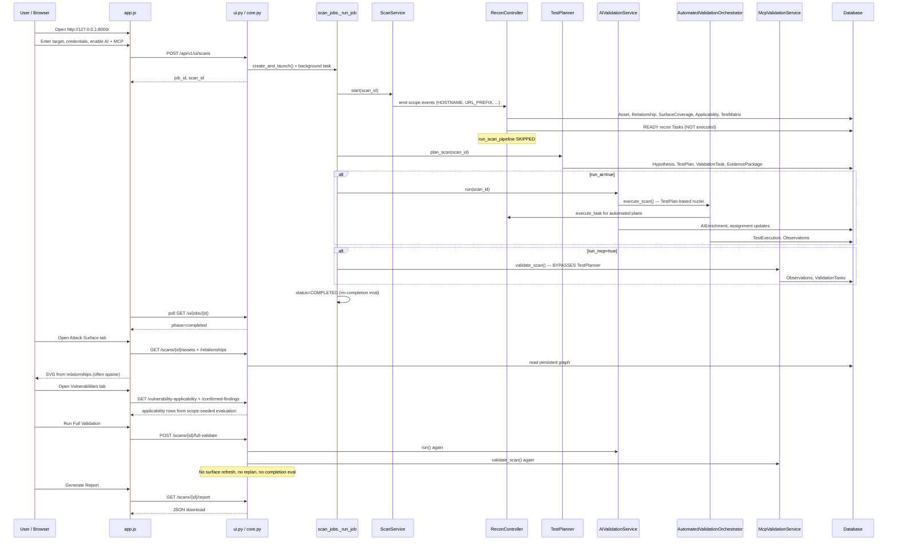

# Current Runtime Flow

**Date:** 2026-07-07  
**Scope:** Actual behavior when a user operates the Web UI today (default `.env`: `SCAN_START_INLINE_EXECUTION=false`).

---

## Flow Diagram (What Actually Runs)



---

## Step-by-Step Trace

### Step 1: Open Web UI

| Layer | Detail |
|-------|--------|
| **UI** | `init()` → `checkApi()` → `GET /health` |
| **API** | `health.py:12` |
| **DB** | None |
| **Gap** | None |

---

### Step 2: Enter Target

| Layer | Detail |
|-------|--------|
| **UI** | `#hostInput`, optional `#usernameInput`, `#passwordInput` |
| **Storage** | Form fields only; not persisted until scan launch |

---

### Step 3: Optional Username / Password

| Layer | Detail |
|-------|--------|
| **UI** | Collected in `scanCredentials()` |
| **API** | Passed in `ScanLaunch` body |
| **Service** | `scan_jobs.create_and_launch` → `with_auth_url()` embeds in URL |
| **Credential service** | **NOT USED** — no `CredentialReference`, `AuthenticationContext` |
| **Gap** | Raw credentials in job memory (`_username`, `_password`); passed to MCP URL only |

---

### Step 4: Enable AI Validation

| Layer | Detail |
|-------|--------|
| **UI** | `#aiInput` checked → `run_ai: true` |
| **Effect** | Phase `ai_validation` runs in background job |

---

### Step 5: Enable Tool Validation

| Layer | Detail |
|-------|--------|
| **UI** | `#mcpInput` checked → `run_mcp: true`; `#mcpActiveInput` → `run_mcp_active` |
| **Effect** | Phase `tool_validation` runs `McpValidationService` |

---

### Step 6: Start Scan

| Step | File / Symbol |
|------|---------------|
| UI submit | `app.js:startScan()` |
| API | `POST /api/v1/ui/scans` → `ui.py:launch_ui_scan()` |
| Service | `scan_jobs.create_and_launch()` |
| DB write | `Project`, `Scan`, `ScopeSnapshot` |
| Background | `asyncio.create_task(_run_job(...))` |

---

### Step 7: Wait for Background Job

| Phase | Service | DB Writes | Engines Bypassed |
|-------|---------|-----------|------------------|
| `reconnaissance` | `ScanService.start()` | Assets, relationships, surface, applicability, matrix, READY tasks | **Full recon pipeline** (tasks not executed) |
| `planning` | `TestPlanner.plan_scan()` | TestPlan, Hypothesis, ValidationTask | N/A |
| `ai_validation` | `AIValidationService.run()` | TestExecution, AIEnrichment, task assignments | N/A (uses TestPlans) |
| `tool_validation` | `McpValidationService.validate_scan()` | MCP Observations, ValidationTasks | **TestPlanner, CapabilityMatcher, SafetyPolicy, VerdictEngine** |
| `completed` | Status flag only | None | **AssessmentCompletionEvaluator** |

**Job poll:** `app.js:pollJob()` → `GET /ui/jobs/{id}` every 2.5s

---

### Step 8: Open Attack Surface Tab

| Step | Detail |
|------|--------|
| UI | `loadTab("graph")` → `loadGraph()` |
| API | `GET /scans/{id}/assets`, `GET /scans/{id}/relationships` |
| Source | **Persisted** `Relationship` rows |
| Gap | Often only scope-seeded assets; missing endpoint/parameter nodes |

---

### Step 9: Open Vulnerability Tab

| Step | Detail |
|------|--------|
| UI | `loadTab("vulns")` → `loadVulns()` |
| API | `GET /scans/{id}/vulnerability-applicability`, `GET /confirmed-findings` |
| Source | `AssetVulnerabilityApplicability` from scope-triggered applicability |
| Gap | Not driven by test matrix coverage or verdicts |

---

### Step 10: Run Full Validation

| Step | Detail |
|------|--------|
| UI | `runFullValidation()` → `POST /scans/{id}/full-validate` |
| API | `ui.py:run_full_validation()` |
| Step A | `AIValidationService.run()` — TestPlan nuclei + Mistral + backlog assignment |
| Step B | `McpValidationService.validate_scan()` — direct nuclei/Burp/sqlmap |
| **NOT called** | SurfaceCompletenessEngine refresh, applicability reevaluate, TestPlanner replan, CapabilityMatcher, completion evaluator |

**This is the "TARGET → RECON → AI → NUCLEI+BURP+SQLMAP → REPORT" shortcut** (recon minimal, report separate).

---

### Step 11: Generate Report

| Step | Detail |
|------|--------|
| UI | `downloadReport()` → `GET /scans/{id}/report` |
| API | `core.py:scan_report()` — aggregates 15+ queries |
| Gap | Missing observations, evidence_packages, scanner_findings, change_events; events count only |

---

## Where Intended Architecture Is Bypassed

| Intended Component | Bypass Location | Reason |
|--------------------|-----------------|--------|
| **Adaptive recon pipeline** | `scan_jobs` never calls `run_scan_pipeline` | `SCAN_START_INLINE_EXECUTION=false` |
| **SurfaceCompletenessEngine** (post-validation) | Full-validate, job completion | Not in orchestrator |
| **VulnerabilityApplicabilityEngine** (refresh) | Full-validate | MCP reads stale applicability |
| **TestMatrixEngine** (refresh) | Full-validate | No rebuild after new evidence |
| **TestPlanner** | `McpValidationService` entire path | Parallel validation shortcut |
| **CapabilityMatcher** | MCP validators, full-validate MCP leg | Direct tool invocation |
| **SafetyPolicy** (formal) | MCP sqlmap/nuclei | Only `active_allowed` boolean |
| **CredentialContextService** | UI credential fields | URL embedding only |
| **EvidenceGraph** | MCP positive hits | Observations only; no EvidenceLink until verdict |
| **VerdictEngine** | MCP path | Creates ValidationTask, not verdict |
| **RecursiveCorrelationEngine** | Everywhere | Never called |
| **AssessmentCompletionEvaluator** | Job `completed` status | Only inside AI orchestrator sub-call |

---

## Alternative Flow: CLI / Integration Tests (More Complete Recon)

`run_real_assessment.py` and integration tests set `SCAN_START_INLINE_EXECUTION=true`:

```
ScanService.start → run_scan_pipeline → execute all READY tasks → AssessmentCompletionEvaluator
→ TestPlanner.plan_scan
```

This path **does** exercise SurfaceCompletenessEngine, ApplicabilityEngine, TestMatrixEngine, and CapabilityRegistry during recon — but **still excludes** MCP validators and UI job orchestration.

---

## Comparison: Claimed vs Actual

| Claimed lifecycle stage | Default UI scan |
|-------------------------|-----------------|
| Adaptive reconnaissance | Scope seed only |
| Normalized observations | From scope events + MCP if enabled |
| Asset identity resolution | Minimal |
| Attack surface graph | Basic persisted edges |
| Surface completeness | Initial compute only |
| Vulnerability applicability | Initial compute only |
| Per-asset test matrix | Built on scope seed |
| Test requirements | Created in matrix |
| Test planner | **Yes** |
| Capability matcher (validation) | **No** |
| Safety policy (validation) | Partial (automated path only) |
| Credential context | **No** |
| Eligible validation adapter | **No** (MCP hardcoded) |
| Evidence graph | **No** (until manual verdict) |
| Verdict engine | Manual API only |
| Correlation engine | **No** |
| Assessment completion | **No** at job end |
| Report | Manual download |
