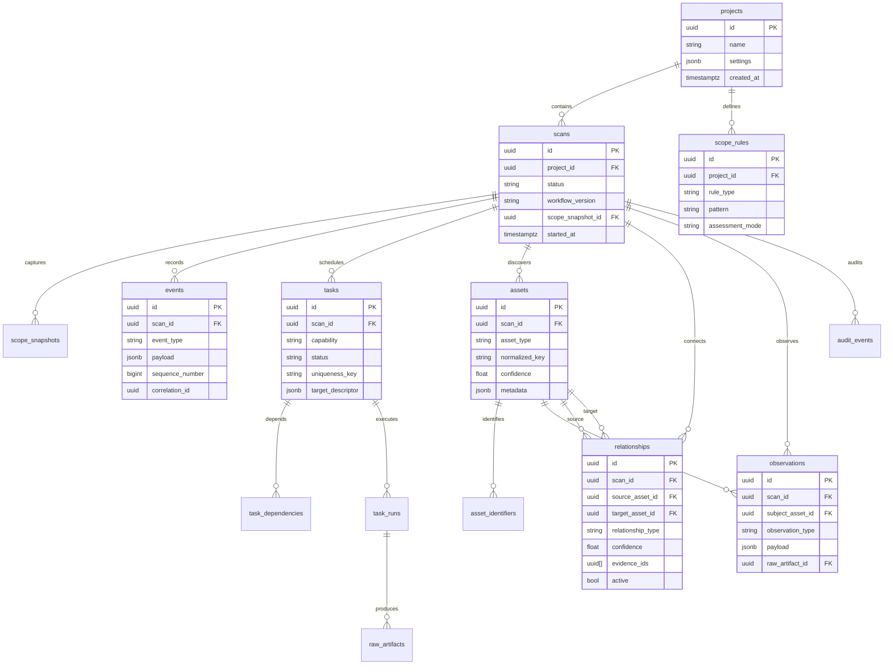

# Phase 1 Implementation Plan — Core State Model

## Status

Proposed (pending approval to begin implementation)

## Prerequisites

- [x] Phase 0 architecture documents complete and internally consistent
- [ ] Stakeholder review of domain model and scope boundaries

## Objective

Establish the persistent foundation: projects, scans, scope, assets, observations, events, tasks, task runs, and relationships — with database migrations, repository layer, basic API stubs, and tests.

**Not in Phase 1:** Controller logic, scheduler, real tools, correlation, hypotheses, AI, MCP.

---

## 1. Project directory structure

```
vapt_automate/
├── docs/                          # Phase 0 (complete)
├── src/
│   └── vapt_platform/
│       ├── __init__.py
│       ├── main.py                # FastAPI app factory
│       ├── config/
│       │   ├── __init__.py
│       │   └── settings.py        # Pydantic Settings
│       ├── domain/
│       │   ├── __init__.py
│       │   ├── enums.py           # All domain enums
│       │   ├── models/            # Pydantic domain models (API/events)
│       │   │   ├── project.py
│       │   │   ├── scan.py
│       │   │   ├── asset.py
│       │   │   ├── observation.py
│       │   │   ├── event.py
│       │   │   ├── task.py
│       │   │   └── relationship.py
│       │   └── exceptions.py
│       ├── db/
│       │   ├── __init__.py
│       │   ├── base.py              # SQLAlchemy declarative base
│       │   ├── session.py           # Engine, session factory
│       │   └── tables/              # SQLAlchemy ORM models
│       │       ├── project.py
│       │       ├── scan.py
│       │       ├── scope.py
│       │       ├── asset.py
│       │       ├── observation.py
│       │       ├── event.py
│       │       ├── task.py
│       │       └── relationship.py
│       ├── repositories/            # Data access layer
│       │   ├── base.py
│       │   ├── project.py
│       │   ├── scan.py
│       │   ├── scope.py
│       │   ├── asset.py
│       │   ├── observation.py
│       │   ├── event.py
│       │   ├── task.py
│       │   ├── relationship.py
│       │   └── graph.py             # GraphRepository protocol + PG impl
│       ├── services/                # Application services (thin in Phase 1)
│       │   ├── project.py
│       │   ├── scan.py
│       │   └── scope.py
│       ├── scope/
│       │   ├── __init__.py
│       │   ├── manager.py           # ScopeManager (full logic Phase 1)
│       │   └── matchers.py          # Domain, IP, URL matchers
│       ├── api/
│       │   ├── __init__.py
│       │   ├── deps.py              # DI, DB session
│       │   ├── routes/
│       │   │   ├── health.py
│       │   │   ├── projects.py
│       │   │   └── scans.py
│       │   └── schemas/             # API request/response DTOs
│       ├── cli/
│       │   ├── __init__.py
│       │   └── main.py              # Typer app (project-create, scan-create)
│       └── logging/
│           └── setup.py             # Structured logging + correlation ID
├── alembic/
│   ├── env.py
│   └── versions/
│       └── 001_initial_schema.py
├── config/
│   └── default.yaml
├── tests/
│   ├── conftest.py
│   ├── unit/
│   │   ├── test_scope_manager.py
│   │   ├── test_asset_identity.py
│   │   └── test_enums.py
│   ├── integration/
│   │   ├── test_project_scan_crud.py
│   │   ├── test_event_persistence.py
│   │   └── test_relationship_graph.py
│   └── property/
│       └── test_scope_properties.py
├── docker-compose.yml
├── Dockerfile
├── Makefile
├── pyproject.toml
├── alembic.ini
├── .pre-commit-config.yaml
└── README.md
```

---

## 2. Database entity diagram



---

## 3. Phase 1 deliverables checklist

### 3.1 Infrastructure

- [ ] `pyproject.toml` with dependencies: fastapi, uvicorn, sqlalchemy, alembic, pydantic-settings, typer, redis (stub), psycopg, pytest, hypothesis, ruff, mypy
- [ ] `docker-compose.yml`: postgres, redis, api
- [ ] `Makefile`: `dev`, `test`, `lint`, `migrate`, `typecheck`
- [ ] `.pre-commit-config.yaml`: ruff, mypy
- [ ] `config/default.yaml` + environment variable overrides

### 3.2 Database

- [ ] Alembic initial migration with all Phase 1 tables
- [ ] Indexes per architecture spec (scan_id, asset_type, normalized_key, task status, event type, relationship endpoints)
- [ ] UUID primary keys, timestamptz columns

### 3.3 Domain layer

- [ ] All enums from domain-model.md in `domain/enums.py`
- [ ] Pydantic models for API and event envelopes
- [ ] Domain exceptions: `ScopeDenied`, `DuplicateTask`, `EntityNotFound`

### 3.4 Scope Manager

- [ ] Rule matchers: ROOT_DOMAIN, HOSTNAME, CIDR, IP, URL_PREFIX, EXCLUSION, PORT_RESTRICTION
- [ ] Assessment mode: PASSIVE_ONLY, ACTIVE, CREDENTIALED
- [ ] `evaluate(target, capability, scope_snapshot) → ScopeDecision`
- [ ] Audit event on every evaluation
- [ ] Unit tests + Hypothesis property tests for matcher correctness

### 3.5 Repositories

- [ ] CRUD for projects, scans, scope rules
- [ ] Append-only event repository with sequence number generation
- [ ] Asset repository with normalized_key upsert (non-destructive)
- [ ] Relationship repository with supersede pattern
- [ ] Task repository with uniqueness_key constraint
- [ ] GraphRepository PostgreSQL implementation (neighbors, basic path)

### 3.6 Application services

- [ ] `ProjectService.create/get`
- [ ] `ScanService.create` (creates scope snapshot, emits SCAN_CREATED event stub)
- [ ] `ScanService.pause/resume/cancel` (status transitions only)
- [ ] `ScopeService` for rule management

### 3.7 API (minimal)

- [ ] `GET /health`, `GET /ready` (DB connectivity)
- [ ] `POST /projects`, `GET /projects/{id}`
- [ ] `POST /scans`, `GET /scans/{id}`, pause/resume/cancel
- [ ] `GET /scans/{id}/assets`, `/events`, `/tasks`, `/relationships` (paginated)
- [ ] Correlation ID middleware

### 3.8 CLI (minimal)

- [ ] `project-create`, `scan-create`, `scan-status`
- [ ] `asset-list` (read-only)

### 3.9 Tests

| Test | Type |
|------|------|
| Scope rule matching (include/exclude) | Unit |
| Scope property: excluded target always denied | Property |
| Project/scan CRUD roundtrip | Integration |
| Event append with sequence ordering | Integration |
| Relationship create + graph neighbor query | Integration |
| Task uniqueness constraint | Integration |
| Asset normalized_key upsert idempotency | Integration |

---

## 4. Phase 1 exclusions (explicit)

- Recon Controller processing pipeline
- Workflow engine YAML loading
- Scheduler and Celery workers
- Tool adapters and parsers
- Finding ingestion
- Correlation and hypothesis engines
- Coverage and change detection
- AI and MCP
- Frontend

---

## 5. Implementation order (suggested sprints)

### Sprint 1.1 — Scaffold (2–3 days)

1. pyproject.toml, docker-compose, Makefile
2. Settings, logging, FastAPI app skeleton
3. SQLAlchemy base + session
4. Health endpoints

### Sprint 1.2 — Projects and scans (2–3 days)

1. ORM models: projects, scans, scope_rules, scope_snapshots
2. Alembic migration
3. Repositories + services
4. API routes + CLI commands
5. Integration tests

### Sprint 1.3 — Assets and relationships (3–4 days)

1. ORM: assets, asset_identifiers, relationships
2. Asset identity normalized_key generation
3. GraphRepository implementation
4. API list endpoints
5. Integration tests

### Sprint 1.4 — Events, observations, tasks (3–4 days)

1. ORM: events, observations, tasks, task_dependencies, task_runs, audit_events
2. Event repository with sequencing
3. Task uniqueness constraint
4. Scope Manager full implementation
5. Unit + property tests

### Sprint 1.5 — Hardening (1–2 days)

1. Ruff + mypy clean
2. README with setup instructions
3. Review against domain-model.md checklist
4. Phase 1 completion summary

**Estimated duration:** 2–3 weeks

---

## 6. Definition of done (Phase 1)

- [ ] All Phase 1 tables migrated
- [ ] Scope Manager passes unit and property tests
- [ ] API endpoints return correct data for manual CRUD flow
- [ ] CLI can create project → create scan → list assets (empty)
- [ ] `make test lint typecheck` passes in CI
- [ ] No controller/scheduler code merged (boundary respected)
- [ ] Documentation updated if any deviation from Phase 0 docs

---

## 7. Risks and mitigations

| Risk | Mitigation |
|------|------------|
| Schema drift from domain-model.md | Entity checklist review before migration |
| Over-building Phase 1 | Strict exclusions list; defer controller to Phase 2 |
| Scope matcher edge cases | Hypothesis property tests; known test vectors |
| Graph query performance | Depth limits; indexes; defer optimization |

---

## 8. Handoff to Phase 2

Phase 1 completion enables:

- Event store ready for controller to consume
- Asset/relationship model ready for fake adapter output
- Scope Manager ready for triple-check integration
- Task table ready for scheduler (Phase 3)

Phase 2 first task: implement `ReconController.handle_event()` with fake `PASSIVE_DOMAIN_DISCOVERY` adapter vertical slice per architecture.md Phase 2 spec.
