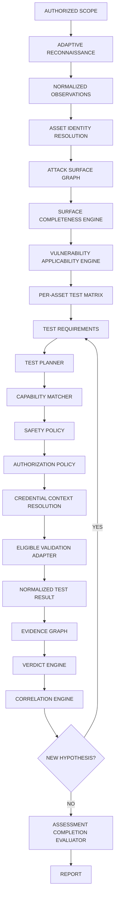

# Target Runtime Flow

**Date:** 2026-07-07  
**Purpose:** Define the intended evidence-driven assessment lifecycle the platform must implement. This is the **target state** after integration migration — not current behavior.

---

## Master Pipeline



---

## User Action: Run Full Assessment

**User-facing label:** Run Full Assessment (may retain existing button ID).

**Internal meaning:** Evaluate all applicable vulnerability test requirements for all eligible in-scope assets and execute all currently authorized automated test plans.

**NOT:** Run AI + Nuclei + Burp + sqlmap against everything.

### Orchestration Sequence

```
Run Full Assessment
  ↓
1. Validate scope (ScopeManager)
  ↓
2. Execute pending recon tasks / run_scan_pipeline until quiescent or budget
  ↓
3. Refresh SurfaceCompletenessEngine for all web/service/API assets
  ↓
4. Reevaluate VulnerabilityApplicabilityEngine (all affected assets)
  ↓
5. Rebuild TestMatrixEngine (asset × surface × class where applicable)
  ↓
6. Ensure TestRequirement rows exist with reasoning_trace + source_rule_ids
  ↓
7. TestPlanner.plan_scan — create/update TestPlans for eligible requirements
  ↓
8. For each TestPlan with testing_mode=AUTOMATED:
     a. CapabilityMatcher → eligible providers
     b. SafetyPolicy → allow/reject
     c. AuthorizationPolicy → allow/reject
     d. CredentialContext → resolve if credential_requirement set
     e. ProviderSelectionDecision → record explainable choice
     f. Adapter execution (nuclei / burp-import / sqlmap / ...)
     g. ResultNormalizer → Observation + ScannerFinding + Evidence
  ↓
9. For ASSISTED/MANUAL requirements → ValidationTask (no auto-confirm)
  ↓
10. Emit VALIDATION_RESULT_RECORDED / TEST_EXECUTION_COMPLETED events
  ↓
11. EvidenceGraph.update — link observations to hypotheses
  ↓
12. VerdictEngine.reevaluate affected hypotheses (no AI verdicts)
  ↓
13. RecursiveCorrelationEngine.run — relationship-driven hypotheses
  ↓
14. If new TestRequirements → return to step 7 (bounded by idempotency + max depth)
  ↓
15. AssessmentCompletionEvaluator.evaluate
  ↓
16. Optional: AIContextBuilder → Mistral advisory (post-deterministic, bounded input)
  ↓
17. Return assessment status + summary (not merely job status)
```

---

## Test Requirement as Bridge

Every test requirement must answer **"Why does this exist?"** via:

```json
{
  "reasoning_trace": {
    "rule_ids": ["RULE-AUTHZ-OBJECT-001"],
    "facts": ["authenticated_endpoint", "object_identifier_observed", "multiple_roles_known"],
    "applicability_state": "APPLICABLE"
  },
  "source_rule_ids": ["RULE-AUTHZ-OBJECT-001"],
  "required_capability": "WEB_ACTIVE_ASSESSMENT",
  "testing_mode": "ASSISTED",
  "credential_requirement": "AUTHENTICATED",
  "completion_conditions": { "min_evidence_types": ["request_response_pair"] }
}
```

**Required model extensions** (on `TestRequirement` or linked surface record):

| Field | Status today | Target |
|-------|--------------|--------|
| `scan_id` | via matrix | direct or denormalized |
| `asset_id` | via matrix | direct |
| `surface_id` | missing | new or endpoint asset FK |
| `vulnerability_class_id` | yes | yes |
| `applicability_status` | `applicability_state` | rename/alias |
| `testing_mode` | yes | yes |
| `required_capability` | partial (`eligible_capabilities[]`) | single primary + list |
| `coverage_status` | yes | yes |
| `safety_class` | on TestPlan only | on requirement |
| `authorization_requirement` | on TestPlan only | on requirement |
| `credential_requirement` | missing | UNAUTH / AUTH / ROLE_SPECIFIC |
| `required_evidence` | yes | yes |
| `completion_conditions` | on TestPlan only | on requirement |
| `priority` | on TestPlan | on requirement |
| `reasoning_trace` | on TestPlan only | **on requirement** |
| `source_rule_ids` | missing | from applicability rules |

---

## Capability-Based Validator Routing

Validators become **providers of capabilities**, not orchestration entry points.

| Capability | Provider(s) | Safety default |
|------------|-------------|----------------|
| `TEMPLATE_BASED_ASSESSMENT` | nuclei CLI | LOW_IMPACT |
| `WEB_PASSIVE_ASSESSMENT` | Burp MCP (history + scanner import) | PASSIVE |
| `WEB_ACTIVE_ASSESSMENT` | authorized DAST when policy permits | STATE_CHANGING |
| `INJECTION_VALIDATION` | sqlmap MCP adapter | ACTIVE (gated) |
| `NETWORK_VULNERABILITY_ASSESSMENT` | nmap/nuclei network templates | LOW_IMPACT |

**ProviderSelectionDecision** (new record):

```
test_plan_id, required_capability, eligible_providers[], rejected_providers{},
rejection_reasons{}, selected_provider, selection_rule, timestamp
```

---

## Nuclei Target Behavior

Execute only when:

- Target in scope
- TestRequirement exists with `required_capability=TEMPLATE_BASED_ASSESSMENT`
- TestPlan status allows execution
- Templates satisfy SafetyPolicy
- Completion conditions not already met
- Rate/concurrency policy permits

Store per execution: template_id, template_version, asset_id, surface_id, test_requirement_id, test_plan_id, evidence_ids.

Positive output → `Observation` + `ScannerFinding` + `Evidence` → **not** `ConfirmedFinding`.

---

## Burp MCP Target Behavior

**Actual capabilities (implemented today):**

- Read scanner issues (`get_scanner_issues`)
- Read proxy HTTP history via regex (`get_proxy_http_history_regex`)

**Declared capability:** `WEB_PASSIVE_ASSESSMENT` / `VULNERABILITY_FINDING_IMPORT`

Normalize to: Observation, ScannerFinding, Evidence with source, asset mapping, endpoint mapping, confidence, timestamp.

Feed: graph, surface inventory, test matrix, hypothesis engine, verdict engine.

**Does not:** trigger scans, send requests, active assessment.

---

## sqlmap MCP Target Behavior

Eligibility requires ALL:

- Structured endpoint context (method, URL, parameter location, content-type)
- TestRequirement with injection-related class
- TestPlan exists and approved
- SafetyPolicy permits active test
- `active_allowed=true` on assessment request
- Credential context if required
- Coverage not already complete

---

## Credential Target Behavior

UI username/password → runtime-only:

```
CredentialReference (metadata)
  → CredentialScopeBinding
    → AuthenticationContext
      → RoleContext (if role)
```

Never persist raw secrets in DB, logs, events, reports, AI prompts, MCP responses.

Track coverage: UNAUTHENTICATED / AUTHENTICATED / ROLE_SPECIFIC separately in report.

---

## Evidence Graph Target

| Link type | Source → Target |
|-----------|-----------------|
| SUPPORTS | Observation → Hypothesis |
| CONTRADICTS | Observation → Hypothesis |
| SUPPORTS | ScannerFinding → Hypothesis |
| CONFIRMS | ValidationResult → Hypothesis |
| REJECTS | ValidationResult → Hypothesis |
| TRIGGERS | ChangeEvent → TestRequirement |
| REQUIRES | CoverageGap → TestRequirement |

Every verdict references evidence_ids.

---

## Verdict Gating Target

States: `UNTESTED`, `TESTING`, `PARTIALLY_VALIDATED`, `CONFIRMED`, `REJECTED`, `INCONCLUSIVE`, `REQUIRES_MANUAL_REVIEW`

**ConfirmationPolicy** rules per vulnerability class — explicit module.

AI **cannot** assign verdicts or create ConfirmedFinding.

---

## Recursive Correlation Target

On `VALIDATION_RESULT_RECORDED` / `TEST_EXECUTION_COMPLETED`:

```
normalize → store evidence → update asset/relationship state
→ update test coverage → reevaluate hypotheses
→ run correlation rules → new TestRequirement?
→ completion evaluation
```

Idempotency: event keys, rule execution tracking, hypothesis uniqueness, requirement uniqueness.

**Deterministic scenarios** (minimum):

1. JS references endpoint not in crawl → endpoint candidate + coverage gap
2. Shared IdP, asymmetric auth coverage → cross-app auth hypothesis
3. New service on reachable asset → change event + characterization requirement
4. Shared config evidence across findings → correlation candidate (not auto-merge)
5. Auth credentials available, unauth complete, auth incomplete → authenticated gap

---

## AI Advisory Target Placement

```
Deterministic engines → evidence package → optional AI explanation → analyst advisory
```

AI may: summarize, explain, classify noisy text, suggest taxonomy, summarize gaps.

AI may not: confirm findings, assign severity, choose intrusive tests, execute tools, modify scope, retrieve credentials, generate executable commands, change verdicts, bypass safety.

Components: `AIContextBuilder`, `AIRequestBudget`, `AIResponseSchema`, `AIResultCache`.

`AI_MAX_TOKENS=0` = high response ceiling; **input context must remain bounded**.

---

## Assessment Completion Target

Separate:

| Concept | Meaning |
|---------|---------|
| `JOB_FINISHED` | Background worker exited |
| `ASSESSMENT_COMPLETE` | Completion evaluator satisfied |

Completion states: `COMPLETE`, `COMPLETE_WITH_ACCEPTED_GAPS`, `INCOMPLETE`, `BLOCKED`, `INCONCLUSIVE`

Evaluates: discovery, DNS, service, web, crawl, historical URL, content, parameter, JS, API, authenticated, role, applicable class coverage, automated tests, manual backlog, inconclusive count, unresolved contradictions.

---

## Report Target Sections

```
metadata, scope, workflow_versions, tool_versions,
assets, relationships, attack_surface, surface_inventory, surface_coverage,
observations, scanner_findings, finding_correlations,
vulnerability_applicability, test_matrix, test_requirements, test_plans,
test_executions, hypotheses, evidence_packages, validation_results,
verdicts, confirmed_findings, rejected_hypotheses, inconclusive_tests,
coverage_gaps, authenticated_coverage, role_coverage,
manual_validation_backlog, change_events, assessment_completion_status,
AI_advisory, limitations
```

Every confirmed finding: asset_ids, surface_ids, evidence_ids, validation_result_ids, verdict_id, source observations, timestamps.

---

## UI Target

**Primary sidebar capabilities** (not raw tool names):

- Discovery
- Surface Mapping
- Network Assessment
- Web Assessment
- API Assessment
- Authenticated Assessment
- Template-Based Assessment
- AI Analyst Advisory

**Advanced:** individual tool enable/disable (existing Configure tools).

**Tabs:** Overview, Assets, Attack Surface, Surface Coverage, Vulnerability Applicability, Test Matrix, Hypotheses, Validation Backlog, Evidence, Confirmed Findings, Changes, AI Advisory

**Attack Surface node drill-down:** observations, relationships, technologies, endpoints, parameters, auth metadata, findings, hypotheses, coverage, changes.

---

## Success Metrics (Not Tool Count)

- % attack surface modeled
- % applicable classes covered
- % evidence traceable
- % test requirements completed
- useful cross-asset correlations
- relationship-driven hypotheses
- authenticated surfaces assessed
- inconclusive areas explicit
- confirmed finding accuracy
- validation backlog clarity
